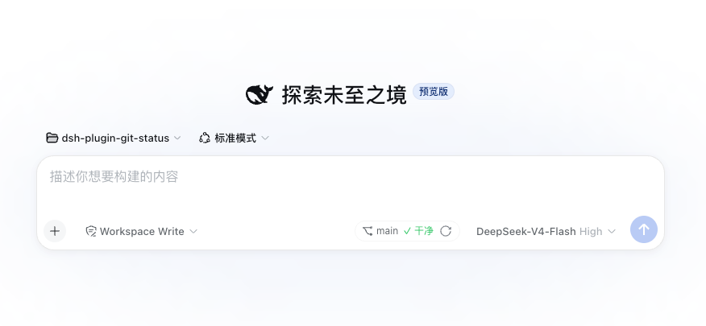
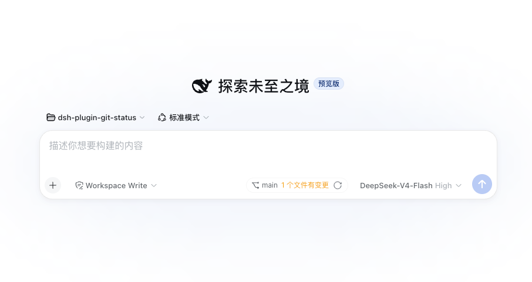
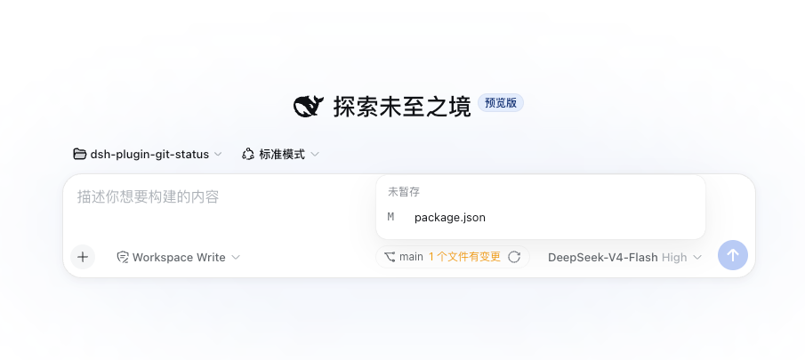

# dsh-plugin-git-status

A [DeepSeek Harness](https://github.com/deepseek-ai/deepseek-harness) plugin that
shows the git status of the current workspace. It is **read-only**: it never
creates, modifies, or deletes any file.

- **Git status panel** — a small chip in the composer tool row, to the left of
  the model selector. It shows the branch name, a clean/dirty summary, and a
  manual refresh button. When the working tree has changes, the change count is
  clickable and expands into a grouped file list (conflicted / staged /
  unstaged / untracked) with porcelain status codes and rename origins. The
  panel refreshes every 30 seconds and hides entirely when the workspace is not
  a git repository.
- **`git_status` model tool** — callable through the normal tool pipeline.
  Returns structured JSON with the branch, commits ahead/behind upstream,
  grouped change counts, the file list, and the most recent commit. It accepts
  an optional `cwd`; when omitted it inspects the current session workspace.

## Screenshots

Clean workspace — the chip shows the branch and a green "✓ clean" summary:



Workspace with changes — the change count is a clickable text that opens the
grouped file list:



Workspace with changes, file list expanded — grouped by conflicted / staged /
unstaged / untracked; each row shows the porcelain status code, the path, and
the original path for renames:



## Supported Harness version

`0.2.0-rc.2` (the plugin peer-depends on the same `@deepseek-ai/*` package
versions, `cordis` `^4.0.4` and `schemastery` `^3.18.4`). For older Harness
releases use plugin `0.5.0` (`0.1.2-alpha.4`), `0.4.0` (`0.1.1-rc.1`) or `0.3.0`
(`0.1.0-rc.7`).

## Install

```bash
dsh plugin --profile <name> add dsh-plugin-git-status
```

If the CLI is not installed globally:

```bash
npx @deepseek-ai/dsh plugin --profile <name> add dsh-plugin-git-status
```

Replace `<name>` with your profile name (e.g. `web`). Restart the Harness
process after installing, then hard-refresh the browser page.

For a reproducible install, pin a commit (replace the example with the real
commit SHA):

```bash
dsh plugin --profile <name> add github:<owner>/dsh-plugin-git-status#0123456789abcdef0123456789abcdef
```

## Configuration

The panel auto-refresh cadence is configurable at runtime from the browser:
open the **Plugins** panel, select the **dsh-plugin-git-status** bundle, and use
the **Git status** form on its page (`refreshIntervalMs`). The field is a
volatile Host configuration value: a save is written to the profile's
configuration document and committed into the running plugin, so the panel
picks the new cadence up without a page reload. On a deployment whose profile
does not expose plugin configuration, the form is not rendered at all.

It can also be set through the plugin's Cordis row. Add a `config` block for
the `dsh-plugin-git-status` row in your profile's `cordis.patch.yml`:

```yaml
- id: dsh-plugin-git-status
  name: dsh-plugin-git-status
  config:
    refreshIntervalMs: 60000
```

- `refreshIntervalMs` — milliseconds between automatic refreshes
  (default `30000`, upper bound `3600000`). Set it to `0` to disable
  auto-refresh entirely; the panel then only updates on the manual refresh
  button or when the workspace changes.
- Auto-refresh is also paused while the browser tab is hidden, and resumes
  (with an immediate refresh) when the tab becomes visible again.

## Update / remove

Use the CLI's update and remove commands:

```bash
dsh plugin --profile <name> remove dsh-plugin-git-status
dsh plugin --profile <name> add dsh-plugin-git-status
```

## Data storage

The plugin stores nothing. Git status is computed on demand by running
read-only `git status` / `git log` commands in the inspected directory.

## Known limitations

- The panel is session-scoped and reflects the active session's workspace. If
  the session has no workspace directory, the panel is not shown.
- Paths with two or more consecutive spaces are read from `git status -z`, so
  they are preserved exactly.
- The panel does not offer inline file operations; it only reports status.

## Changelog

Notable changes per release are documented in
[CHANGELOG.md](./CHANGELOG.md).

## Development

```bash
npm install
npm run typecheck
npm test
npm run build
```

`npm run build` emits `lib/index.js` (Host), `lib/typert.js` (Remote
descriptor) and `lib/client.js` (browser bundle). `npm test` covers the
pure git parser, the Host half on a real Cordis context, the browser half's slot
and Remote wiring, and the Typert wire contract — the last one runs the real
`typert-loader` validator and Typert registry, so a codec that loses its
`create()` factory fails here instead of at plugin mount.
